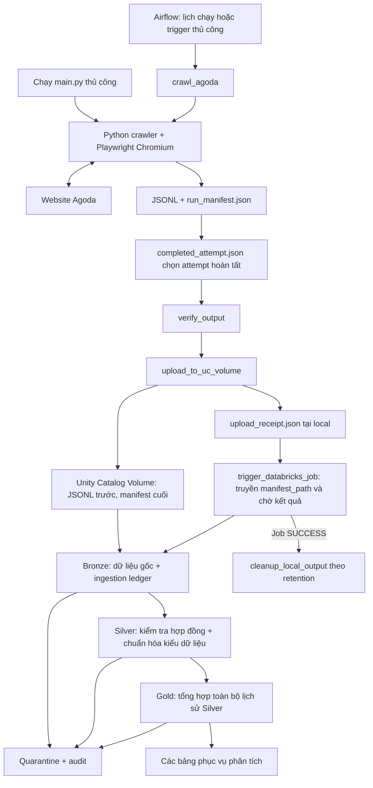

# Luồng hoạt động và công nghệ của dự án Agoda

Tài liệu mô tả luồng được triển khai trong repository: thu thập thông tin khách
sạn Agoda bằng Playwright, điều phối bằng Apache Airflow, rồi xử lý dữ liệu trên
Databricks theo ba lớp Bronze, Silver và Gold.

Các phiên bản và giá trị mặc định bên dưới được đối chiếu với code, Dockerfile
và dependency files. Cấu hình môi trường có thể ghi đè các giá trị mặc định;
tài liệu này không xác nhận trạng thái triển khai của Docker hay workspace.

## 1. Sơ đồ tổng thể



Airflow quản lý pipeline bên ngoài Databricks. Databricks Job quản lý thứ tự
Bronze → Silver → Gold. Khi chạy `main.py` thủ công, lệnh kết thúc ở output
local; các bước verify, upload và trigger thuộc luồng Airflow.

## 2. Công nghệ sử dụng

| Thành phần | Công nghệ / phiên bản trong repo | Vai trò |
| --- | --- | --- |
| Ngôn ngữ | Python; Docker dùng Python 3.12 | CLI, crawler, scripts điều phối và package ETL. |
| Tự động hóa trình duyệt | Playwright `1.60.0`, Sync API, Chromium | Tìm kiếm qua giao diện Agoda, đọc DOM, cuộn trang và mở trang chi tiết. |
| Song song trong crawler | `ThreadPoolExecutor`, `Queue`, `threading.BoundedSemaphore` | Chạy nhiều job, chia việc detail và giới hạn tổng detail workers. |
| Điều phối pipeline | Apache Airflow `3.3.0`, `BashOperator`, `LocalExecutor` | Lập lịch, retry và thực hiện chuỗi task. |
| Môi trường chạy Airflow | Docker, Docker Compose | Đóng gói crawler, Chromium và các service Airflow. |
| Metadata của Airflow | PostgreSQL `16` | Lưu trạng thái vận hành Airflow; dữ liệu khách sạn được đưa vào Databricks. |
| Kết nối Databricks | `databricks-sdk==0.72.0` | Upload qua Files API và gọi/chờ Jobs API. |
| Lưu file nguồn | Databricks Unity Catalog Volume | Lưu JSONL và manifest theo từng batch/attempt. |
| Xử lý dữ liệu | Apache Spark qua PySpark và Spark SQL | Đọc dữ liệu, kiểm tra chất lượng, chuyển kiểu và tổng hợp. |
| Lưu bảng | Delta tables trong Unity Catalog | Bronze, Silver, Gold, ledger, quarantine và audit; hỗ trợ `MERGE`. |
| Hợp đồng dữ liệu | YAML, PyYAML; root pin `6.0.3` | Khai báo và đọc schema/rules đầu vào phiên bản `1.1.0`. |
| Định dạng trao đổi | JSONL, JSON | JSONL chứa quan sát khách sạn; JSON chứa manifest, pointer và receipt. |
| Công cụ phát triển | pytest `9.0.3`, Ruff, mypy | Kiểm thử, lint và kiểm tra kiểu dữ liệu. |

Nguồn: [requirements.txt](../requirements.txt),
[requirements-dev.txt](../requirements-dev.txt),
[Dockerfile](../airflow/Dockerfile), [Docker Compose](../airflow/docker-compose.yml)
và [cấu hình ETL](../databricks/agoda_etl/config.py). PySpark được cung cấp bởi
môi trường Databricks; root requirements phục vụ crawler và các scripts local.

## 3. Luồng thu thập dữ liệu trong crawler

### Bước 1 — Nhận cấu hình và tạo job

`main.py` nhận tham số CLI rồi gọi `agoda_crawler/orchestration.py`. Với các
tham số crawler có hỗ trợ cấu hình môi trường, thứ tự ưu tiên là:

```text
CLI > environment variables > .env > giá trị fallback trong code
```

`jobs.py` tạo ma trận destination × ngày check-in. Check-out tự động là ngày
kế tiếp. Orchestration xử lý lần lượt từng ngày lưu trú; trong cùng ngày,
các job destination có thể chạy song song. Mỗi outer worker dùng một browser
riêng và tái sử dụng browser đó cho các job được giao.

### Bước 2 — Tìm khách sạn qua giao diện Agoda

`navigation/` mở homepage, thao tác tìm kiếm với địa điểm, ngày và số khách,
rồi chờ danh sách hotel cards. URL tìm kiếm và trang detail yêu cầu tiền tệ VND.
Browser context có routing để chặn tài nguyên không thiết yếu theo cấu hình;
fallback hiện chặn `image`, `font`, `media` và một số URL tracking.

### Bước 3 — Cuộn, trích xuất và gộp listing

`listing/` cuộn vùng danh sách, lấy DOM snapshots và gộp record ngay trong từng
vòng cuộn để giữ lại hotel cards khi giao diện thay đổi. `extraction/` đọc tên,
URL, giá, rating, review count và star rating từ selector/parser.

Record được nhận diện bằng URL chuẩn hóa và property identity; có fallback
bằng tên khi thiếu identity mạnh hơn. Khóa URL giữ numeric `propertyId` vì các
khách sạn khác nhau có thể dùng chung đường dẫn. Merge bổ sung trường còn thiếu
và loại trùng giữa các vòng cuộn cũng như giữa các trang.

### Bước 4 — Xác minh pagination

Crawler so sánh bằng chứng nội dung listing sau khi điều hướng để xác nhận
trang mới. Chỉ thay đổi URL chưa đủ để chấp nhận một trang.

| Điểm dừng | Ý nghĩa trong kết quả job |
| --- | --- |
| `max_pages_reached` | Đã đạt giới hạn trang yêu cầu. `max_pages=0` bỏ giới hạn này. |
| `end_of_results` | Có bằng chứng hết kết quả từ pagination hiển thị; có thể dừng trước giới hạn trang. |
| `low_new_records` | Heuristic thấy ít record mới; ghi `incomplete` nếu chưa có bằng chứng hết kết quả. |
| `duplicate_page`, `pagination_navigation_failed`, `crawl_error` | Job thất bại. |

Manifest ghi kết quả từng destination/ngày, kể cả job không trả record.
Orchestration đánh dấu batch thất bại nếu có job chưa hoàn tất.

### Bước 5 — Bổ sung thông tin từ trang detail

Khi bật enrichment và pagination của job đã `complete`, `enrichment/detail.py`
chọn record cần bổ sung theo cấu hình rồi mở trang khách sạn. Chế độ mặc định
ưu tiên field còn thiếu; danh sách field mặc định là
`price_value,rating_text,review_count_text`.

Ba giới hạn song song có vai trò riêng:

| Cấu hình | Phạm vi |
| --- | --- |
| `AGODA_WORKERS` / `--workers` | Số outer workers xử lý job destination/ngày. |
| `AGODA_DETAIL_CONCURRENCY` / `--detail-concurrency` | Số detail workers trong một job. |
| `AGODA_TOTAL_DETAIL_CONCURRENCY` / `--total-detail-concurrency` | Giới hạn detail workers chung cho mọi job đồng thời. |

Hàng đợi chia record cho detail workers; semaphore giữ tổng concurrency trong
giới hạn. Profile local được mô tả trong `AGENTS.md` dùng 2 outer workers,
detail concurrency 3 và tổng detail concurrency 3; fallback trong code có thể
khác với profile `.env`.

### Bước 6 — Ghi output và trạng thái batch

Sau khi các job của một ngày hoàn tất, orchestration gom record, ghi JSONL
public và cập nhật manifest. Record public cần có `hotel_name`, `hotel_url`,
`price_value`. Giá là số nguyên VND dương được lưu dưới dạng chuỗi.

Record thiếu trường bắt buộc được đưa vào diagnostics. Thiếu rating/review/star
vẫn được giữ; coverage của từng field phải **lớn hơn 90%** để tránh warning theo
fallback hiện tại. Warning coverage không tự làm batch thất bại.

Khi toàn bộ ngày/job hoàn tất, manifest chuyển sang `complete` và crawler ghi
`completed_attempt.json` ở cấp batch để downstream chọn đúng attempt.

## 4. Luồng điều phối Airflow

DAG [agoda_daily_crawl.py](../airflow/dags/agoda_daily_crawl.py) có chuỗi task:

```text
crawl_agoda
  → verify_output
  → upload_to_uc_volume
  → trigger_databricks_job
  → cleanup_local_output
```

| Task | Công việc |
| --- | --- |
| `crawl_agoda` | Gọi `main.py` với DAG ID, run ID, try number và ngày crawl. |
| `verify_output` | Đọc completion pointer; kiểm tra identity, manifest `complete`, kết quả từng job và file JSONL khai báo có tồn tại, không rỗng. |
| `upload_to_uc_volume` | Xác minh lại attempt, upload JSONL trước và manifest cuối; ghi receipt local có đường dẫn, kích thước và SHA-256 của file local. |
| `trigger_databricks_job` | Lấy chính xác remote manifest từ receipt, truyền `manifest_path` vào một Databricks Job và chờ kết quả `SUCCESS`. |
| `cleanup_local_output` | Dọn attempt cũ đủ điều kiện retention và đã có manifest complete/receipt khớp; bỏ qua batch đang chạy. |

Giá trị mặc định của DAG: lịch `15 4 * * *` tức 04:15 theo
`Asia/Ho_Chi_Minh`, `catchup=False`, `max_active_runs=1`, retry 1 lần sau 5 phút.
Ngày check-in bằng ngày cuối data interval cộng 21 ngày; có thể đổi offset qua
parameter `check_in_offset_days`. Retention local mặc định 14 ngày, tính từ
thời điểm upload trong receipt.

Compose chạy PostgreSQL, `airflow-init`, API server, scheduler và DAG processor.
Với `LocalExecutor`, các task thực thi trong scheduler container. DAG được tạo
ở trạng thái paused theo cấu hình Compose.

## 5. Luồng xử lý Databricks

Setup một lần dùng `setup_uc_objects_wrapper` để chuẩn bị schema và bảng.
Daily Job gồm ba notebook phụ thuộc nhau:

```text
ingest_bronze_wrapper → transform_silver_wrapper → build_gold_wrapper
```

Notebook chỉ nhận `project_root`, `manifest_path` rồi gọi package
[`agoda_etl`](../databricks/agoda_etl/). Mỗi lần chạy bắt đầu từ một manifest
`complete` cụ thể và chỉ đọc các file được liệt kê trong đó.

### Bronze — Giữ dữ liệu nguồn và kiểm soát ingestion

[`bronze.py`](../databricks/agoda_etl/bronze.py) đọc từng dòng JSONL bằng Spark,
giữ nội dung nguồn trong `raw_record_json` và bổ sung provenance từ manifest.
Số dòng vật lý phải khớp `publishable_records` được khai báo cho file.

Các dòng lỗi JSON được ghi quarantine với `quarantine_layer=bronze`. Các trường
nghiệp vụ được kiểm tra ở Silver. Bronze cũng áp dụng ngưỡng lỗi chung: vượt
10% input hoặc 200 record thì bước xử lý thất bại.

`record_id` là SHA-256 kết hợp `batch_id`, đường dẫn file nguồn và dòng JSON gốc.
Bronze ghi bằng `MERGE` theo khóa này. Ledger theo `(batch_id, file_path)` có
trạng thái `loading`, `loaded`, `failed`; file đã `loaded` được bỏ qua khi retry.

### Silver — Kiểm tra hợp đồng và chuẩn hóa

[`silver.py`](../databricks/agoda_etl/silver.py) chọn Bronze của đúng batch và các
file trong manifest, rồi áp dụng
[`agoda_hotel.yaml`](../databricks/contracts/agoda_hotel.yaml): required fields,
URL, giá dương, timestamp, ngày, rating, review count, star rating và điều kiện
check-out sau check-in.

Giá trị optional không rỗng nhưng sai định dạng được chuẩn hóa về zero trước
validation; giá trị optional bị thiếu vẫn giữ null. Record vi phạm được ghi
quarantine với `quarantine_layer=silver`. Vượt 10% input hoặc 200 record lỗi
làm Silver thất bại; Silver cũng dừng nếu không còn record hợp lệ.

Record hợp lệ được chuyển thành các cột như `price_amount`, `rating`,
`review_count`, `star_rating`, `check_in_date` và timestamp. `MERGE` theo
`record_id` giữ lịch sử quan sát và tránh chèn lại cùng record khi chạy lại.

### Gold — Tạo bảng phân tích

[`gold.py`](../databricks/agoda_etl/gold.py) đọc **toàn bộ lịch sử Silver** rồi
ghi đè bốn bảng tổng hợp. Batch mới kích hoạt việc tính lại các bảng này.

Bốn lần ghi diễn ra tuần tự, không phải một transaction chung. Gold ghi audit
`running` trước khi publish, `success` sau khi cả bốn bảng hoàn tất, hoặc
`failed` khi có exception. Lỗi giữa chừng có thể để lại các bảng ở hai phiên
bản khác nhau; crash có thể giữ audit ở `running`. Consumer chờ Job và audit
Gold của lần refresh tương ứng thành công, đồng thời tránh đọc trong một
refresh khác. Audit thành công của batch cũ không bảo đảm kết quả khi batch
mới đang chạy hoặc đã thất bại. Xem [hợp đồng publish Gold](../databricks/README.md#gold-publication).

| Bảng trong `agoda.gold` | Nội dung |
| --- | --- |
| `agoda_hotel_daily_summary` | Giá min/avg/max, rating, review/star và số quan sát theo khách sạn, destination, ngày check-in. |
| `agoda_destination_daily_summary` | Số khách sạn phân biệt theo URL, giá và rating tổng hợp theo destination/ngày. |
| `agoda_rating_distribution` | Phân bố nhóm rating và giá trung bình. |
| `agoda_price_by_star` | Giá trung bình, median xấp xỉ và rating theo hạng sao. |

## 6. Dữ liệu và các file điều khiển

Ví dụ layout local dưới output root của Airflow; các ID trong đường dẫn được
encode để dùng được trên Windows/Linux:

```text
data/airflow/
└── dag_id=<dag-id>/
    └── batch_id=<dag-id>__<airflow-run-id>/
        ├── completed_attempt.json
        └── attempt=<crawler-try-number>/
            ├── agoda_hotels_YYYY-MM-DD.jsonl
            ├── run_manifest.json
            └── upload_receipt.json
```

| Artifact | Vai trò |
| --- | --- |
| JSONL | Mỗi dòng là một quan sát khách sạn; chứa business fields và thông tin ngày/địa điểm crawl. |
| `run_manifest.json` | Identity Airflow, cấu hình thực thi, Git revision, timestamps, kết quả từng job và danh sách output. |
| `completed_attempt.json` | Chọn attempt đã hoàn tất trong batch; downstream đọc pointer này. |
| `upload_receipt.json` | Biên lai local xác nhận upload của đúng attempt; dùng để xác định remote manifest và retention. |
| `debug/<batch-id>/...` | Diagnostics theo destination/ngày và summary/ngày; phục vụ điều tra. |

Trên Volume, JSONL và manifest giữ layout tương ứng dưới
`/Volumes/agoda/raw/crawler/dag_id=.../batch_id=.../attempt=.../`.
Metadata Airflow ở manifest được Bronze gắn vào các dòng khi ingestion.

Các bảng hỗ trợ ngoài Gold gồm:

| Bảng | Vai trò |
| --- | --- |
| `agoda.raw.agoda_hotels_bronze` | Dữ liệu nguồn và provenance. |
| `agoda.raw.agoda_ingestion_ledger` | Theo dõi ingestion theo file. |
| `agoda.raw.agoda_hotel_quarantine` | Giữ record lỗi và quy tắc vi phạm ở Bronze/Silver. |
| `agoda.raw.agoda_pipeline_audit` | Ghi số lượng và trạng thái xử lý theo layer/batch. |
| `agoda.silver.agoda_hotels_history` | Lịch sử quan sát đã chuẩn hóa. |

## 7. Retry và xử lý thất bại

- Mỗi DAG run xác định một batch; `airflow_try_number` của crawler xác định
  attempt. Crawler từ chối dùng lại thư mục attempt đã tồn tại.
- Manifest incomplete/failed hoặc file khai báo thiếu/rỗng bị chặn trước upload.
- Manifest được upload cuối để làm tín hiệu batch sẵn sàng cho ingestion.
- Trigger Databricks dùng idempotency token theo DAG ID/run ID. Retry trong cùng
  DAG run có thể nhận lại Databricks run đã tạo; một lần so sánh độc lập cần DAG
  run mới.
- Ledger và `MERGE record_id` bảo vệ việc chạy lại Bronze/Silver. Một batch mới
  vẫn có thể lưu quan sát mới của cùng khách sạn/ngày.
- Databricks trả kết quả khác `SUCCESS` làm task trigger thất bại; cleanup
  downstream không chạy. Cleanup chỉ xử lý các bản local cũ đủ điều kiện,
  giữ batch hiện tại để tra cứu.

## 8. Cấu hình và hướng dẫn vận hành

Root `.env` cung cấp cấu hình crawler, lịch/retention Airflow và kết nối
Databricks. Các scripts upload/trigger hiện tạo `WorkspaceClient` bằng
`DATABRICKS_HOST`, `DATABRICKS_TOKEN` trong môi trường container. Docker Compose
nạp root `.env`; CLI OAuth trên máy host là một luồng xác thực riêng.

Điểm bắt đầu khi vận hành:

1. Chuẩn bị Unity Catalog Volume, upload package ETL và chạy setup notebook.
2. Cấu hình Databricks Job gồm ba notebook tasks và parameter `manifest_path`.
3. Cấu hình root `.env`, build image và khởi động Airflow bằng Compose.
4. Unpause/trigger DAG, theo dõi manifest, receipt và kết quả Databricks Job.
5. Kiểm tra audit/quarantine cùng các bảng Silver và Gold để đánh giá kết quả.

Chi tiết và lệnh thực hiện nằm trong [README](../README.md),
[Airflow runbook](../airflow/README.md), [Databricks README](../databricks/README.md)
và [crawler runbook](RUNBOOK.md).

## 9. Bản đồ code để đọc tiếp

| Khu vực | Trách nhiệm |
| --- | --- |
| [`main.py`](../main.py), [`config.py`](../agoda_crawler/config.py), [`jobs.py`](../agoda_crawler/jobs.py) | Đầu vào, cấu hình và tạo job. |
| [`orchestration.py`](../agoda_crawler/orchestration.py) | Worker batches, output, manifest và completion pointer. |
| [`crawler.py`](../agoda_crawler/crawler.py) | Vòng đời crawl một destination/ngày. |
| [`navigation/`](../agoda_crawler/navigation/), [`listing/`](../agoda_crawler/listing/), [`extraction/`](../agoda_crawler/extraction/), [`enrichment/`](../agoda_crawler/enrichment/) | Search, thu listing, pagination, parser và detail. |
| [`airflow/scripts/`](../airflow/scripts/) | Verify, upload, trigger Job và cleanup. |
| [`databricks/agoda_etl/`](../databricks/agoda_etl/) | Contract, ETL, setup, quarantine và audit. |
| [`tests/`](../tests/), [`pyproject.toml`](../pyproject.toml) | Kiểm thử và cấu hình Ruff/mypy. |

OpenSpec và Superpowers hỗ trợ quy trình phát triển theo
[`AGENTS.md`](../AGENTS.md); luồng chạy dữ liệu ở trên được thực hiện bởi crawler,
Airflow và Databricks.
